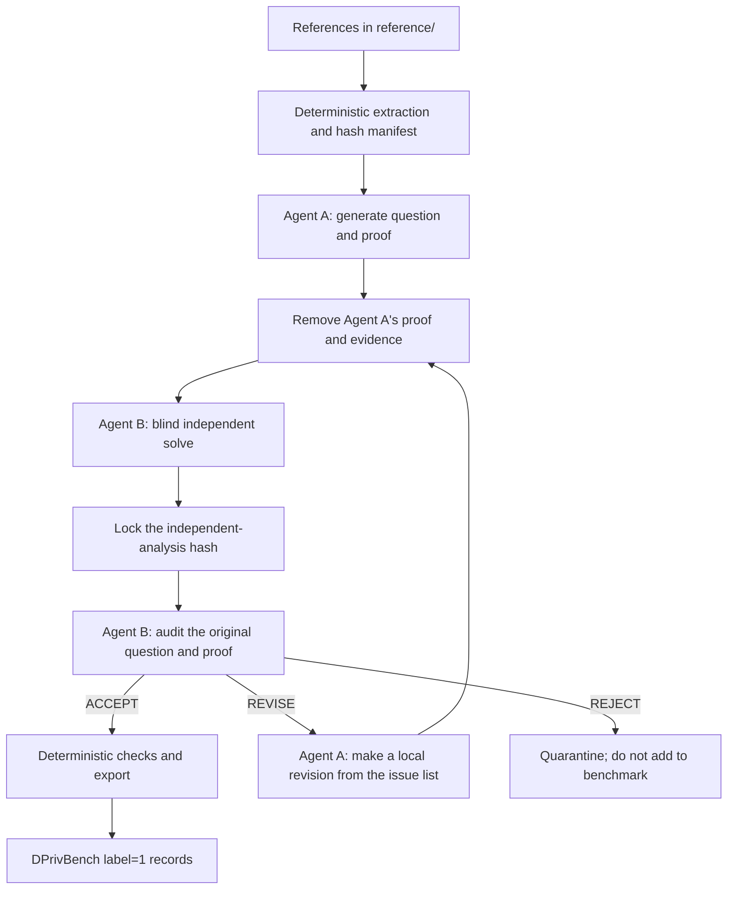

# DPrivBench Positive Question/Proof: Two-Agent Workflow

This protocol divides the task of generating positive questions and proofs from
given references into two mathematically focused, mutually isolated roles:

- **Agent A — Generator**: faithfully derives Yes-answer questions from the
  references and supplies checkable proofs.
- **Agent B — Verifier**: independently solves each question without seeing
  Agent A's proof, then audits the complete candidate.

The primary Codex task only coordinates file handoffs, hash locking, revision
loops, and export. It makes no mathematical judgment and therefore is not a
third domain agent.

## 1. Safety goals

Every exported record must satisfy all of the following:

1. `question_tex` is complete, unambiguous, and has Yes as its correct answer.
2. The adjacency relation, DP notion, parameter domain, mechanism, noise scale,
   and conclusion agree with the source.
3. `comments` contains an independently checkable proof, not merely a pointer
   to a theorem.
4. At least one precise source anchor—page, theorem, lemma, equation, or
   section—supports the central claim.
5. Agent B independently concludes Yes and returns `ACCEPT` in the full audit.
6. All deterministic schema, hash, LaTeX, uniqueness, and deduplication checks
   pass.

The workflow optimizes for precision rather than yield. It rejects candidates
instead of guessing when evidence is insufficient, PDF formula extraction is
damaged, or a material ambiguity remains.

## 2. Inputs and directory layout

Place references in `reference/`. Supported formats are `.pdf`, `.txt`, `.md`,
and `.tex`. An optional `reference/metadata.json` can provide metadata keyed by
relative source path:

```json
{
  "mironov2017.pdf": {
    "citation": "mironov2017renyi",
    "title": "Rényi Differential Privacy",
    "authors": ["Ilya Mironov"],
    "publish_year": "2017",
    "pdf_link": "https://arxiv.org/pdf/1702.07476",
    "subject": "Accounting and Composition",
    "topic": "Accounting"
  }
}
```

Use a separate directory for every run, for example `runs/rdp-001/`:

```text
runs/rdp-001/
├── reference_manifest.json
├── sources/
├── generator_output.json
├── verifier_question_view.json
├── verifier_independent.json
├── verifier_audit_bundle.json
├── verifier_audit.json
├── accepted_positive_questions.json
└── accepted_positive_provenance.json
```

`reference_manifest.json` locks the original files and extracted text with
SHA-256 hashes. Any source change requires a new run.

## 3. State machine



At most two `REVISE` rounds are allowed. A candidate that still fails after the
second revision goes to human review. A `REJECT` candidate must not be silently
rewritten into a new claim and accepted.

## 4. Agent A: Generator

Agent A may read only:

- `reference_manifest.json`;
- the extracted texts listed under `sources/`;
- `dpriv_positive_workflow/schemas/generator_output.schema.json`.

Agent A must not read:

- existing label-0 or negative questions;
- Agent B's prompt or previous audits;
- candidates from other runs;
- proofs of similar questions in the final benchmark.

### Generation rules

- A candidate must be a theorem, lemma, corollary, proposition, or direct
  one-step instantiation of a result in the source.
- Generate only closed claims whose answer is Yes. Do not generate open-ended
  discussion or explanation questions.
- Do not weaken assumptions, expand parameter ranges, switch between
  add/remove and replace-one adjacency, change the DP notion, or alter constants.
- If the conclusion depends on other source results, the proof must list those
  dependencies and their precise anchors.
- Every symbol must be defined in the question or be an explicitly standard
  notation.
- `proof` must show the key derivation. A theorem-number citation by itself is
  insufficient.
- `source_evidence[].quote` should contain only the short excerpt needed for
  location and verification. Mathematical formulas may be preserved.
- Each candidate should express one central conclusion. Keep only one candidate
  when multiple candidates are merely verbal restatements of the same theorem.

Agent A writes its result to `generator_output.json`. It never writes directly
to the benchmark.

## 5. Agent B: Verifier

Agent B starts in a fresh context isolated from Agent A. Verification has two
stages that must not be merged.

### B1: Blind independent solve

The input is `verifier_question_view.json`. It contains only the question,
`source_id`, and locked manifest. It does not contain Agent A's proof,
assumptions list, source evidence, or self-checks.

Agent B must:

1. independently locate the relevant source result;
2. independently answer Yes, No, or Undetermined;
3. write a checkable proof or counterexample;
4. verify adjacency, sensitivity, DP notion, parameter ranges, constants, and
   quantifiers;
5. provide independently found source anchors.

The result is written to `verifier_independent.json` and then locked. It must not
be rewritten during the later audit.

### B2: Full audit

The input is `verifier_audit_bundle.json`, containing:

- Agent A's original candidate;
- the locked B1 independent analysis and its SHA-256;
- the reference-manifest hash.

Agent B compares both proofs and actively stress-tests:

- boundary parameters such as `ε→0`, `δ=0`, `α→1/∞`, empty datasets, and
  single-record datasets;
- minimal neighboring datasets and measurable output events;
- constant factors in noise scale, sensitivity, and composition;
- differences between add/remove and replace-one adjacency;
- sufficient conditions incorrectly promoted to biconditionals or universal
  statements;
- claims about public outputs when the source proves only an internal
  algorithmic quantity;
- hidden regularity, measurability, independence, or boundedness assumptions in
  the source theorem.

Verdicts:

- `ACCEPT`: B1 answers Yes, every hard check passes, Agent A's proof is correct,
  and the candidate is source-faithful.
- `REVISE`: the mathematical claim is correct and only a local,
  claim-preserving fix is needed, such as defining a symbol, adding a proof step,
  or correcting a locator.
- `REJECT`: the claim is false or unsupported, requires a material change to an
  assumption or conclusion, contains a circular or incorrect proof, or cannot
  be verified because extraction quality is inadequate.

Agent B must not silently edit a candidate and accept it. Every change returns
to Agent A, after which B1 and B2 run again.

## 6. Hard acceptance conditions

Every field below in `verifier_audit.json` must be `true`:

- `checks.question_well_posed`
- `checks.claim_correct`
- `checks.proof_correct`
- `checks.source_faithful`
- `checks.assumptions_complete`
- `checks.parameter_domains_correct`
- `checks.adjacency_correct`
- `checks.privacy_notion_correct`
- `checks.constants_correct`
- `checks.citation_locatable`
- `checks.independent_answer_matches`

In addition:

- B1 `independent_answer` must be `yes`;
- all seven B1 independent checks must be `true`, with no `fatal` or `major`
  issue;
- `verdict` must be `ACCEPT`;
- the full audit must contain no `fatal` or `major` issue;
- the question, proof, and independent-analysis hashes must match;
- all schema, LaTeX delimiter, ID uniqueness, and duplicate checks must pass.

Model-reported confidence never substitutes for a hard check.

## 7. DPrivBench export

Only `ACCEPT` candidates are exported. The rich artifact maps to the current
DPrivBench fields as follows:

| Rich artifact | DPrivBench |
|---|---|
| `question_tex` | `question_tex` |
| constant | `label: 1` |
| `citation` | `citation` |
| constant | `negative_mode: "atom"` |
| `pdf_link` | `pdf_link` |
| `publish_year` | `publish_year` |
| newly assigned ID | `question_id`, `related_question` |
| `section_number` | `section_number` |
| `subject` | `subject` |
| `topic` | `topic` |
| `proof` | `comments` |

The exporter writes new files only and never modifies `cate_2.json` in place.
`accepted_positive_provenance.json` retains the source, question, proof, B1, and
audit hashes for later review.

## 8. Commands

PDF extraction requires the bundled Python runtime. Plain-text sources can use
the system Python runtime.

```bash
PY="${DPRIV_PYTHON:-python3}"

$PY dpriv_positive_workflow.py prepare \
  --reference reference \
  --run-dir runs/rdp-001

$PY dpriv_positive_workflow.py validate-generator \
  --run-dir runs/rdp-001

$PY dpriv_positive_workflow.py make-question-view \
  --run-dir runs/rdp-001

$PY dpriv_positive_workflow.py validate-independent \
  --run-dir runs/rdp-001

$PY dpriv_positive_workflow.py make-audit-bundle \
  --run-dir runs/rdp-001

$PY dpriv_positive_workflow.py validate-audit \
  --run-dir runs/rdp-001

$PY dpriv_positive_workflow.py export \
  --run-dir runs/rdp-001 \
  --existing cate_2.json
```

In a new Codex task, the project-level roles load from:

- `.codex/agents/dpriv-positive-generator.toml`
- `.codex/agents/dpriv-positive-verifier.toml`

Recommended startup instruction for the primary Codex task:

> Execute `DPRIVBENCH_POSITIVE_TWO_AGENT_WORKFLOW.md`. Run `prepare` first.
> Use `dpriv_positive_generator` to create `generator_output.json`. Create the
> proof-hidden question view, then use `dpriv_positive_verifier` for B1. Once B1
> is locked, preferably reuse the same live verifier instance for B2. If the
> environment cannot resume that instance, use the same verifier role with the
> locked B1 artifact. Export only positive questions that pass every hard gate.
> Do not widen the reference scope or modify the existing dataset.

## 9. Human spot checks

Even when every automated gate passes, sample at least 10% of each batch before
release. Review 100% of candidates that:

- depend on multiple theorems;
- use PDF extraction marked `low`;
- involve nonstandard adjacency or privacy conversions;
- use a proof route in B1 that differs from Agent A's route;
- passed through any `REVISE` round.
